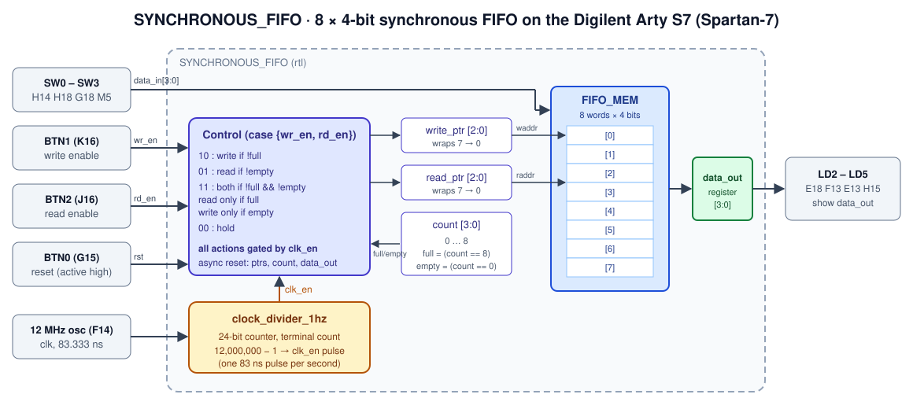
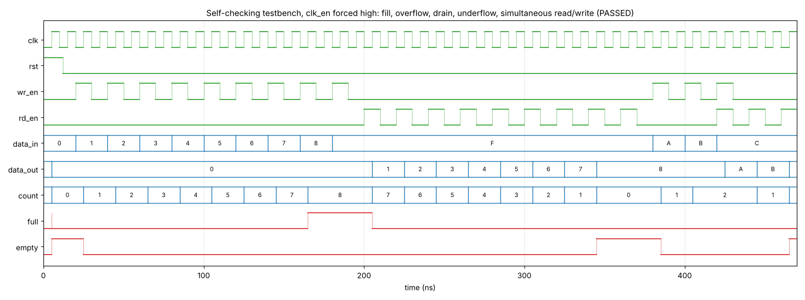

# Synchronous FIFO: Verilog Design and Spartan-7 FPGA Implementation

An **8-deep × 4-bit synchronous FIFO** (first-in, first-out buffer) written in Verilog, synthesised with **Xilinx Vivado**, and run on the **Digilent Arty S7 (Spartan-7)** board. Data is entered on the slide switches, the push buttons write and read, and the FIFO output appears on the LEDs. A built-in 1 Hz clock enable slows the FIFO down so that each button press can be seen by eye.

| | |
|---|---|
| **Top module** | `SYNCHRONOUS_FIFO` |
| **Depth × width** | 8 entries × 4 bits |
| **Clocking** | Single clock domain (12 MHz board oscillator), FIFO operations gated by a 1 Hz enable |
| **Reset** | Asynchronous, active-high |
| **Status** | Internal `full` / `empty` derived from an occupancy counter |
| **Read data** | Registered `data_out` (holds the last value read) |
| **Protection** | Writes ignored when full, reads ignored when empty |
| **Target** | Digilent Arty S7 (XC7S25 / XC7S50), LVCMOS33 I/O |
| **Estimated size** | about 60 LUTs and 71 flip-flops |



---

## Contents

- [What a synchronous FIFO is](#what-a-synchronous-fifo-is)
- [Architecture](#architecture)
- [Ports and board pin mapping](#ports-and-board-pin-mapping)
- [Operation table](#operation-table)
- [Verification](#verification)
- [FPGA implementation](#fpga-implementation)
- [Using it on the board](#using-it-on-the-board)
- [Repository structure](#repository-structure)
- [Running the simulation](#running-the-simulation)
- [Design notes and possible improvements](#design-notes-and-possible-improvements)

---

## What a synchronous FIFO is

A FIFO is a queue in hardware: words come out in the order they went in. *Synchronous* means the write side and the read side share one clock, so the pointers can be compared directly without the Gray-code pointer synchronisers an asynchronous (dual-clock) FIFO needs. Synchronous FIFOs are used for rate matching between pipeline stages, for buffering bursts (UART, SPI or DMA data) and for decoupling a producer from a consumer that occasionally stalls.

---

## Architecture

The design (in the file [`rtl`](rtl)) contains two modules.

### `clock_divider_1hz`

A 24-bit counter that counts board-clock cycles. When it reaches `12_000_000 − 1` it wraps to 0 and drives `clk_en` high for exactly **one** 12 MHz cycle. With the 12 MHz Arty S7 oscillator this is one enable pulse per second.

This is a **clock enable**, not a derived clock: every flip-flop still runs on the single 12 MHz `clk`, so there is no clock-domain crossing or extra clock net for the tools to time.

### `SYNCHRONOUS_FIFO`

| Element | Width | Role |
|---|---|---|
| `FIFO_MEM[0:7]` | 8 × 4 bits | Storage array |
| `write_ptr` | 3 bits | Next location to write; wraps 7 → 0 naturally |
| `read_ptr` | 3 bits | Next location to read; wraps 7 → 0 naturally |
| `count` | 4 bits | Number of stored words, 0 … 8 |
| `full` | wire | `count == 8` |
| `empty` | wire | `count == 0` |
| `data_out` | 4-bit register | Updated only on a successful read |

**Full and empty detection.** With 3-bit pointers, `write_ptr == read_ptr` is true both when the FIFO is empty and when it is full. The design resolves this with a separate occupancy counter that is 1 bit wider than the pointers. That costs four flip-flops but keeps the status logic to a single comparison each.

All state updates happen on the rising edge of `clk`, and only in cycles where `clk_en` is high.

---

## Ports and board pin mapping

Constraints are in [`constraint_file.xdc`](constraint_file.xdc). All pins use LVCMOS33.

| Port | Dir | Width | Arty S7 resource | FPGA pin(s) |
|---|---|---|---|---|
| `clk` | in | 1 | 12 MHz oscillator | F14 (83.333 ns clock constraint) |
| `rst` | in | 1 | BTN0 | G15 |
| `wr_en` | in | 1 | BTN1 | K16 |
| `rd_en` | in | 1 | BTN2 | J16 |
| `data_in[3:0]` | in | 4 | SW0 – SW3 | H14, H18, G18, M5 |
| `data_out[3:0]` | out | 4 | LD2 – LD5 | E18, F13, E13, H15 |

The Arty S7 push buttons are active-high, which matches the active-high `rst`, `wr_en` and `rd_en`.

---

## Operation table

Evaluated on each rising edge of `clk` where `clk_en = 1`:

| `{wr_en, rd_en}` | State | Action | `count` |
|---|---|---|---|
| `00` | any | none | unchanged |
| `10` | not full | `MEM[wptr] ← data_in`, `wptr++` | +1 |
| `10` | full | write ignored (overflow protection) | unchanged |
| `01` | not empty | `data_out ← MEM[rptr]`, `rptr++` | −1 |
| `01` | empty | read ignored (underflow protection); `data_out` keeps its value | unchanged |
| `11` | neither full nor empty | write **and** read in the same cycle | unchanged |
| `11` | full | read only | −1 |
| `11` | empty | write only (no read-through of the new word) | +1 |

`rst` asynchronously clears both pointers, `count` and `data_out`. The memory array is not reset; it does not need to be, because `empty` prevents stale words from being read.

---

## Verification

### Original testbench (`tb.v`)

`tb.v` resets the FIFO, holds `wr_en` while stepping `data_in` through 0 … 8 every 10 ns, then holds `rd_en`. The Vivado waveform below comes from an earlier version of the design **without** the 1 Hz clock enable: eight words are written, and reading returns them in order (0, 1, 2, …).


With the clock divider now in `rtl`, `clk_en` first pulses after 12,000,000 cycles (120 ms at the testbench's 10 ns clock). The original testbench stops at 284 ns, so in simulation it now shows `data_out = 0` the whole time. To simulate the current design, the enable has to be bypassed, as the testbench below does.

### Self-checking testbench

This testbench forces `clk_en` high, then checks every corner case of the operation table automatically:

1. Write 8 words; check that `full` is set.
2. Try a 9th write; check that it is dropped (`count` stays at 8).
3. Read 8 words; check the order and that `empty` is set.
4. Try a read while empty; check that `data_out` is unchanged.
5. Write two words, then read and write in the same cycle; check that the order is preserved and `count` is unchanged.
6. Drain the FIFO and check the last two words.

Result in Icarus Verilog 12: **PASSED, 0 errors.**



<details>
<summary>tb_fifo_selfcheck.v</summary>

```verilog
`timescale 1ns/1ps
module tb_fifo_selfcheck;
  reg clk = 0, rst = 1, wr_en = 0, rd_en = 0;
  reg  [3:0] data_in = 0;
  wire [3:0] data_out;

  SYNCHRONOUS_FIFO dut(.data_out(data_out), .clk(clk), .rst(rst),
                       .wr_en(wr_en), .rd_en(rd_en), .data_in(data_in));

  always #5 clk = ~clk;
  initial force dut.clk_en = 1'b1;          // bypass the 1 Hz enable

  integer i, err = 0;

  task push(input [3:0] d);
    begin @(negedge clk); wr_en = 1; rd_en = 0; data_in = d;
          @(negedge clk); wr_en = 0; end
  endtask

  task pop(input [3:0] exp);
    begin @(negedge clk); rd_en = 1; wr_en = 0;
          @(negedge clk); rd_en = 0;
          if (data_out !== exp) begin
            err = err + 1; $display("FAIL pop: expected %h got %h", exp, data_out);
          end
    end
  endtask

  initial begin
    $dumpfile("fifo.vcd"); $dumpvars(0, tb_fifo_selfcheck);
    #12 rst = 0;

    for (i = 0; i < 8; i = i + 1) push(i + 1);                    // fill
    if (!dut.full)     begin err = err + 1; $display("FAIL: full not set"); end

    push(4'hF);                                                    // overflow
    if (dut.count != 8) begin err = err + 1; $display("FAIL: overflow changed count"); end

    for (i = 0; i < 8; i = i + 1) pop(i + 1);                     // drain in order
    if (!dut.empty)    begin err = err + 1; $display("FAIL: empty not set"); end

    @(negedge clk); rd_en = 1; @(negedge clk); rd_en = 0;          // underflow
    if (data_out !== 4'h8) begin err = err + 1; $display("FAIL: underflow changed data_out"); end

    push(4'hA); push(4'hB);                                        // simultaneous rd + wr
    @(negedge clk); wr_en = 1; rd_en = 1; data_in = 4'hC;
    @(negedge clk); wr_en = 0; rd_en = 0;
    if (data_out !== 4'hA || dut.count != 2) begin
      err = err + 1; $display("FAIL: simultaneous read/write");
    end
    pop(4'hB); pop(4'hC);

    $display("%s: %0d errors", err ? "FAILED" : "PASSED", err);
    $finish;
  end
endmodule
```
</details>

---

## FPGA implementation

The design was synthesised and implemented in **Vivado** for the Spartan-7 on the Arty S7 and tested on the board.

For a vendor-independent estimate, a Yosys `synth_xilinx -family xc7` run on the same RTL gives:

| Resource | Count | Used by |
|---|---|---|
| LUTs (LUT2–LUT6) | 60 | Read multiplexer, next-state and status logic, divider compare |
| Flip-flops with reset (`FDCE`) | 39 | 24-bit divider + `clk_en`, pointers, `count`, `data_out` |
| Flip-flops without reset (`FDRE`) | 32 | The 8 × 4 memory array |
| `CARRY4` | 10 | Divider counter and `count` adder |
| `MUXF7` / `MUXF8` | 28 / 2 | 8:1 read multiplexer |
| I/O buffers | 8 in, 4 out, 1 `BUFG` | |

This is well under 1 % of an XC7S25. The only timing constraint is the 12 MHz clock (83.333 ns period); the deepest logic, the 24-bit divider compare and the 8:1 read multiplexer, is only a few LUT levels, so timing closes with a very large margin.

> Vivado's own utilisation report may differ slightly. It can map the 8 × 4 array to distributed LUT-RAM (`RAM32M`) instead of flip-flops.

---

## Using it on the board

1. Program the Arty S7 with the generated bitstream.
2. Press **BTN0** to reset. The FIFO is now empty and LD2–LD5 are off.
3. **Write:** set a 4-bit value on SW0–SW3 (SW0 is the LSB) and hold **BTN1** until the next 1-second tick. Repeat for up to 8 values. Each second the button is held writes one more word.
4. **Read:** hold **BTN2** through a tick. The oldest value appears on LD2–LD5 (LD2 is the LSB), and each further tick with BTN2 held shows the next value.
5. Writes beyond 8 entries and reads from an empty FIFO are ignored. On an empty read, the LEDs keep showing the last value read.

Because the FIFO only acts once per second, there is no need for button debouncing; a press shorter than one second may be missed, though.

---

## Repository structure

```
Synchronous-FIFO-design/
├── rtl                              # Verilog source: clock_divider_1hz + SYNCHRONOUS_FIFO
├── tb.v                             # Original directed testbench
├── constraint_file.xdc              # Arty S7 pin and clock constraints
├── Screenshot 2026-07-18 225841.png # Vivado behavioural simulation waveform
├── docs/                            # Diagram and waveform used in this README
└── README.md
```

---

## Running the simulation

### Icarus Verilog

```bash
cp rtl fifo.v                                     # tools expect a .v extension
# save the self-checking testbench above as tb_fifo_selfcheck.v
iverilog -g2012 -o fifo.out fifo.v tb_fifo_selfcheck.v
vvp fifo.out                                      # → PASSED: 0 errors
gtkwave fifo.vcd                                  # optional
```

### Vivado

1. Create a project for the Arty S7 part (`xc7s25csga324-1` or `xc7s50csga324-1`).
2. Add `rtl` as a design source (rename it to `fifo.v` first so Vivado recognises it as Verilog).
3. Add `constraint_file.xdc` as a constraint file.
4. Add the testbench as a simulation source and run **Behavioural Simulation**.
5. Run Synthesis → Implementation → Generate Bitstream, then program the board from Hardware Manager.

---

## Design notes and possible improvements

- **File extension.** The source file is named `rtl` with no extension. Renaming it to `sync_fifo.v` lets simulators, Vivado and GitHub syntax highlighting recognise it.
- **Simulation versus hardware divider.** The 12,000,000 terminal count is hard-coded. Making it a parameter (for example `parameter DIV = 12_000_000`) would let a testbench override it with a small value instead of forcing `clk_en`.
- **`FIFO_DEPTH` is not fully parametric.** The pointers are fixed at 3 bits and `count` at 4 bits, so changing `FIFO_DEPTH` alone breaks the design. Deriving the widths with `$clog2(FIFO_DEPTH)`, and adding a `DATA_WIDTH` parameter, would make the FIFO reusable.
- **Expose status flags.** `full` and `empty` are internal wires. Bringing them out as ports (for example to the Arty S7 RGB LEDs) would make overflow and underflow visible on the board.
- **Input synchronisation.** The buttons and switches drive the logic without synchroniser flip-flops. The once-per-second sampling makes metastability extremely unlikely in practice, but a two-flip-flop synchroniser on each input is standard practice for asynchronous inputs.
- **Write when full with a simultaneous read.** In the `11` case, a full FIFO performs only the read. Allowing the write as well, since the read frees a slot in the same cycle, would sustain full throughput at 100 % occupancy.
- **Read latency.** `data_out` is registered and updates on the clock edge after `rd_en` is sampled. A first-word-fall-through (FWFT) variant would present the head of the queue combinationally.

---

## Author

**K. S. Sethurathnam**, IIT (BHU) Varanasi

